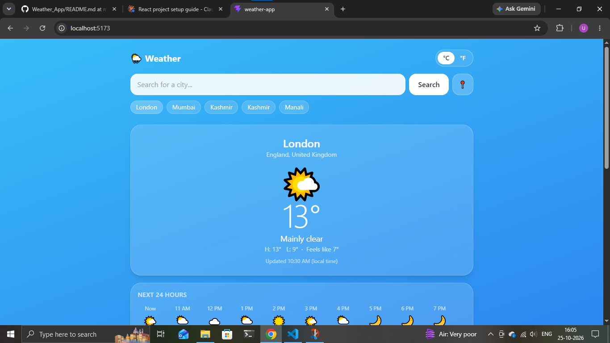

# 🌦️ Weather App

A responsive weather app built with **React, Vite and Tailwind CSS**. Search any city in the world and see live weather, an hourly forecast and a 7-day forecast. The background changes with the weather and the time of day.

Built as part of my **Syntecxhub Virtual Web Development Internship**.

## 📸 Screenshot



## ✨ Features

- Search any city, with suggestions while you type
- Use your current location with one click (📍)
- Current temperature, conditions, and "feels like"
- Next 24 hours hourly forecast
- 7-day forecast with rain chance
- Humidity, wind speed and direction, pressure, UV index, sunrise and sunset
- °C / °F toggle (wind switches between km/h and mph)
- Background theme changes with weather and day or night
- Remembers your last city, recent searches and unit
- Loading and error messages
- Fully responsive (mobile and desktop)

## 🛠️ Tech Stack

- **React** (hooks: `useState`, `useEffect`)
- **Vite**
- **Tailwind CSS**
- **JavaScript (ES6+)**
- **Open-Meteo API** (weather and city search, no API key needed)
- **Browser Geolocation API** and **localStorage**

## 🚀 Run it locally

```bash
git clone https://github.com/umaima8920/Syntecxhub_Weather_App.git
cd Syntecxhub_Weather_App
npm install
npm run dev
```

Then open http://localhost:5173 in your browser.

## 🌐 Live demo

Add your live link here (for example, from Vercel or Netlify).

## 🙏 Credits

Weather data by [Open-Meteo.com](https://open-meteo.com/).

## 👩‍💻 Author

**Umaima Malik**
GitHub: [umaima8920](https://github.com/umaima8920)
LinkedIn: [Umaima Malik](https://www.linkedin.com/in/umaima-malik-62a4213a7)